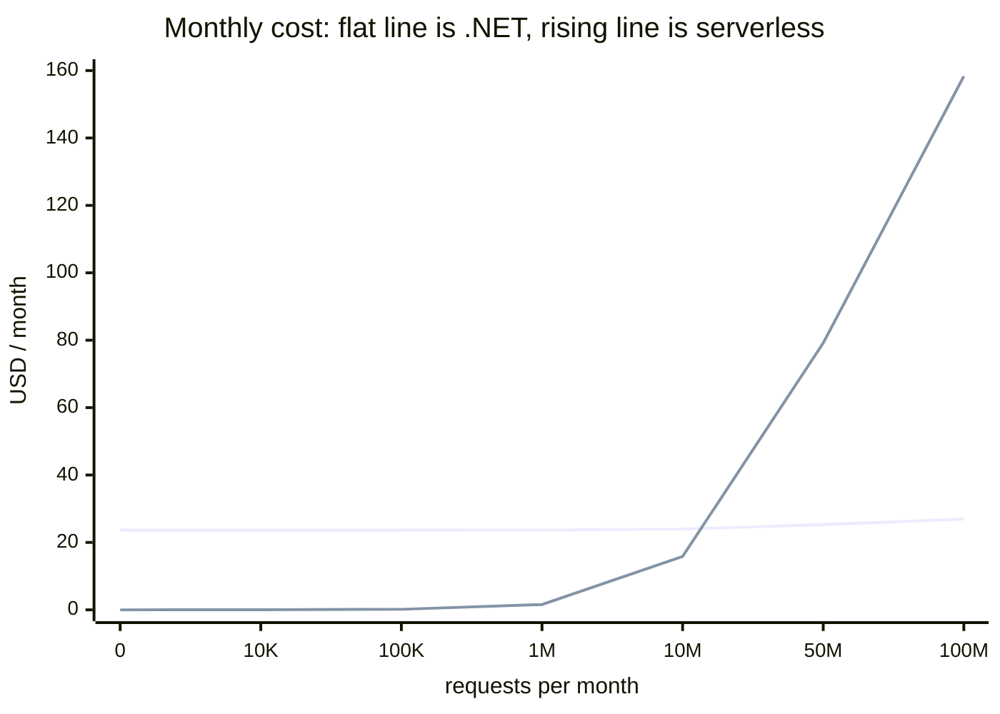

# Cost at scale, and what each approach is actually good at

Two implementations of one API, deployed side by side. This compares what they
cost and where each stops being the right answer.

Every price below is a **us-east-1 list price pulled from the AWS Pricing API**,
and the Lambda figures come from **measured CloudWatch data for this service**,
not estimates. Prices change; the method is in
[the calculation](#how-these-numbers-were-produced) so the numbers can be
re-derived rather than trusted.

For how the data is modelled, see [DATA-MODEL.md](DATA-MODEL.md).

---

## The shape of the difference

One bills for **time**, the other for **work**.

| | `apps/api-dotnet` | `apps/api-serverless` |
|---|---|---|
| Billing | Per hour, whether or not anyone calls | Per request |
| Cost at zero traffic | **$23.63 / month** | **$0.00** |
| Cost at 10 M requests | $23.96 | $15.83 |
| Cost at 100 M requests | $26.91 | $158.33 |

Fargate plus an ALB is almost entirely a fixed floor: going from zero to ten
million requests a month moves the bill by **33 cents**. The serverless stack
starts free and rises in a straight line.



<sub>The <b>flat</b> line is .NET on Fargate + ALB — a fixed floor that barely
moves across four orders of magnitude. The <b>rising</b> line is Lambda + API
Gateway + DynamoDB, free at rest. They cross just past 10M. Note the x-axis
steps by orders of magnitude, so the rising line is genuinely straight;
the apparent curve is the axis, not the cost.</sub>

### Where they cross

**≈ 15.2 million requests per month**, which is about **5.8 requests per second
sustained**. Below that the serverless stack is cheaper; above it, the fixed
floor wins.

That number is lower than people expect, and it is worth saying plainly: an API
Gateway request costs **$1.00 per million** on its own, which is more than the
Lambda and DynamoDB behind it combined. Most of the serverless slope is the
front door, not the compute.

---

## The full breakdown

### `apps/api-dotnet` — fixed cost

| Component | Rate | Monthly |
|---|---|---|
| ALB | $0.0225 / hour | **$16.43** |
| Fargate vCPU | $0.032380 / vCPU-hour × 0.25 | $5.91 |
| Fargate memory | $0.003560 / GB-hour × 0.5 | $1.30 |
| EFS storage | $0.30 / GB-month (database is ~73 KB) | ~$0.00 |
| ALB LCUs | $0.008 / LCU-hour | pennies until real traffic |
| | | **$23.63 floor** |

**The ALB is 70% of it.** It is the single most expensive thing in the stack,
and it exists only because something has to terminate connections in front of
a long-running container.

### `apps/api-serverless` — variable cost

| Component | Rate | Per million requests |
|---|---|---|
| API Gateway (HTTP API) | $1.00 / million | **$1.00** |
| Lambda duration | $0.0000133334 / GB-second (ARM) | $0.13 |
| Lambda requests | $0.20 / million | $0.20 |
| DynamoDB reads | $0.125 / million RRU | $0.13 |
| DynamoDB writes | $0.625 / million WRU | $0.13 |
| DynamoDB storage | $0.25 / GB-month | ~$0.00 |
| | | **≈ $1.58** |

Measured from CloudWatch for this function: **7–15 ms warm**, 87–109 ms for the
heavier layout projection, 234–390 ms cold start, **102 MB used of 512 MB
provisioned**.

> That last figure is an easy saving nobody took. Lambda bills on *allocated*
> memory, so 512 MB costs five times what 128 MB would. The catch is that CPU
> scales with memory — dropping to 128 MB would roughly quadruple duration and
> probably cost more, not less. 256 MB is likely the real optimum, and it is
> the kind of thing worth measuring rather than guessing.

---

## What each is good at

### Fargate + ALB

**Good when** you have steady traffic above the crossover, need a long-lived
process, want predictable billing, or depend on something that cannot be
rebuilt per request — an in-memory cache, a warm connection pool, a background
loop.

**Also good when** the database should be the last line of defence. This is
the implementation whose schema makes bad data unstorable, and that only works
with an engine that enforces constraints.

| Pro | Con |
|---|---|
| Flat bill — a traffic spike costs nothing extra | Idle costs the same as peak |
| No cold starts | Scaling is manual: task count, ALB warm-up |
| Runs anywhere a container runs | The ALB alone is $16/month before a single request |
| Full relational integrity | **Cannot scale horizontally here** — SQLite permits one writer |
| Testable end to end without AWS | Patching, image rebuilds, a VPC to reason about |

**The honest limit of this deployment:** it is pinned to one task because
SQLite allows a single writer, and the database lives on an EFS mount shared by
exactly that task. Throughput is bounded by one container. Going past that
means leaving SQLite — which means leaving the brief.

### Lambda + API Gateway + DynamoDB

**Good when** traffic is spiky, unpredictable, or mostly zero; when scaling to
zero matters; when each request is independent; and when operational surface
area is worth more than per-request cost.

**Bad when** traffic is steady and high, when cold starts are unacceptable on
the tail, or when correctness depends on constraints a key-value store cannot
express.

| Pro | Con |
|---|---|
| $0 when idle | $1 per million just to accept a request |
| Scales out with no capacity planning | Cold starts: 234–390 ms measured here |
| No VPC, no patching, no instances | Auth is untestable without AWS — the authorizer *is* the edge |
| Per-partition isolation that code cannot bypass | No foreign keys: validation is the only guard |
| Independent deploys, small blast radius | Harder to reason about locally; needs a stand-in server |

---

## Which would I choose

**For this service, serverless** — and the reasoning is not cost.

A key remapping API is used when someone sits down to reconfigure a keyboard.
That is bursty, rare, and nowhere near six requests a second sustained. The
crossover sits far above any plausible load, so the serverless stack is both
cheaper and closer to free at rest.

The counterargument is the one the brief actually cares about: **SQLite with
real referential integrity is a better fit for the data**, and the relational
model makes a whole class of bug impossible rather than merely unlikely. If the
constraint set grew — more keyboard models, shared presets, mappings that
reference each other — the relational model would keep paying off while the
DynamoDB one accumulated validation code.

So: serverless for this workload at this scale, relational the moment the data
model earns it. Which is the honest answer to a question that is usually
decided by taste.

---

## How these numbers were produced

Every rate came from the AWS Pricing API, not from documentation or memory:

```bash
aws pricing get-products --region us-east-1 --service-code AWSELB \
  --filters Type=TERM_MATCH,Field=location,Value="US East (N. Virginia)" \
            Type=TERM_MATCH,Field=usagetype,Value=LoadBalancerUsage
```

Lambda duration and memory came from the live function's own logs:

```bash
aws logs get-log-events --log-group-name /aws/lambda/ApexServerlessApi-... \
  | grep "Billed Duration"
```

The model assumes 730 hours a month, a request mix of 80% reads and 20% writes,
one DynamoDB request unit per operation (items are well under the 4 KB read and
1 KB write units), and ~4 KB responses for the ALB's LCU calculation. Lambda
duration is modelled at 20 ms, between the measured warm path and the heavier
layout projection.

Cognito, CloudFront and S3 are excluded: both implementations share them, so
they do not affect the comparison. Cognito is free below 50,000 monthly active
users, and this service has two.
