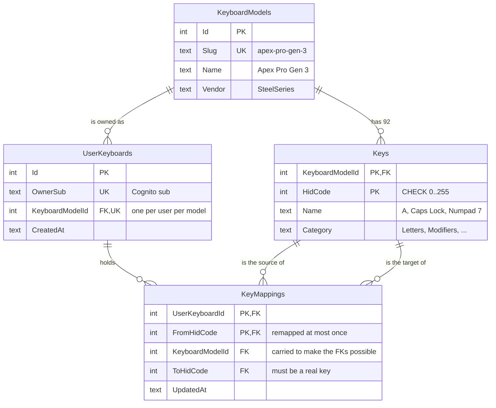
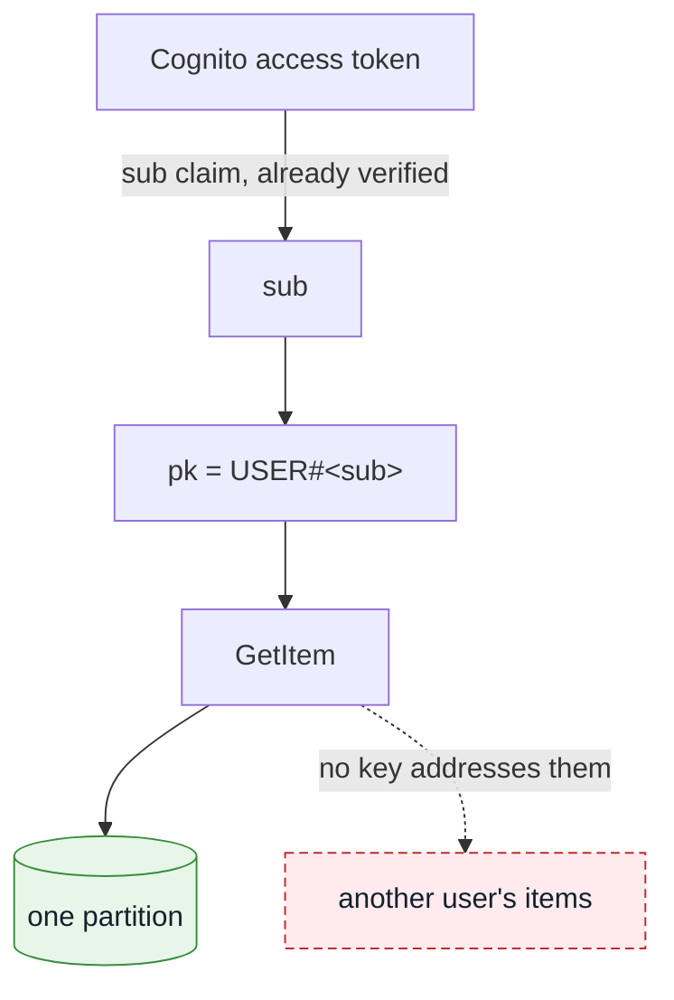

# Two data models, one contract

The same API is implemented twice and both answer byte-identically. Behind
that, the data is shaped completely differently — four normalised tables on
one side, a single item per user on the other.

This document compares them. The short version: **the relational model exists
to let the database refuse bad data, and DynamoDB has nothing to refuse it
with**, so the design that earns its keep in SQLite is pure overhead in
DynamoDB.

For the API itself see [README.md](README.md); for how the repository is laid
out, [REPOSITORY.md](REPOSITORY.md). For what each model costs to run, see
[COST-AND-TRADEOFFS.md](COST-AND-TRADEOFFS.md).

---

## The question each model answers

The brief has one structural requirement worth designing around: *a remapping
points at two keys, and both must exist on the keyboard being remapped.*

A relational database can enforce that. A composite foreign key makes an
impossible remap **unstorable** — not merely rejected by application code that
might have a bug, but refused by the engine.

DynamoDB offers no such mechanism. There are no foreign keys, no cross-item
constraints, no joins. Modelling four "tables" there would buy none of the
guarantees that justify four tables, while costing four round trips to read
one layout.

So the two models diverge at exactly that point, and nowhere else.

---

## Relational: `apps/api-dotnet`

### The line through the middle

`KeyboardModels` and `Keys` are **product facts** — "an Apex Pro Gen 3 has
these 92 keys" is true for everyone, and a migration seeds them.
`UserKeyboards` and `KeyMappings` are **one person's data**. Splitting them is
what makes the catalog shared and the layouts private.

### What the constraints actually do

| Constraint | Makes impossible |
|---|---|
| `PK (UserKeyboardId, FromHidCode)` | Remapping one physical key twice |
| `FK (KeyboardModelId, FromHidCode) → Keys` | A remap *from* a key not on the model |
| `FK (KeyboardModelId, ToHidCode) → Keys` | A remap *to* a key not on the model |
| `FK (UserKeyboardId, KeyboardModelId) → UserKeyboards(Id, KeyboardModelId)` | A mapping claiming a different model than its keyboard |
| `UNIQUE (OwnerSub, KeyboardModelId)` | Two Apex Pro Gen 3s for one user |
| `CHECK (HidCode BETWEEN 0 AND 255)` | A code outside the 8-bit HID range |

`KeyMappings.KeyboardModelId` looks redundant — it is derivable from the
owning `UserKeyboards` row. It is carried deliberately, because without it
there is no column to point the composite foreign keys at. The redundancy
*is* the mechanism, and the fourth constraint above is what stops it
disagreeing with the keyboard it belongs to.

Application validation still runs first, because it reports every problem at
once with a useful message. The constraints are the backstop, and
`SchemaConstraintTests` writes through the `DbContext` to prove they hold.

---

## Key-value: `apps/api-serverless`

One item per user per keyboard. No joins, because there is nothing to join to:
the catalog is bundled with the code rather than stored.

The table below is the real one, read back from the deployed stack. Two
partitions, one per user, each holding a single item today.

<table>
  <thead>
    <tr>
      <th colspan="2" align="center">Primary key</th>
      <th colspan="2" align="center">Attributes</th>
    </tr>
    <tr>
      <th align="left">Partition key: <code>pk</code></th>
      <th align="left">Sort key: <code>sk</code></th>
      <th colspan="2"></th>
    </tr>
  </thead>
  <tbody>
    <tr>
      <td rowspan="2"><code>USER#44d824d8-0091-707a- 0daa-b1df97c0f325</code></td>
      <td rowspan="2"><code>KEYBOARD#apex-pro-gen-3</code></td>
      <td><b>mappings</b></td>
      <td><b>updatedAt</b></td>
    </tr>
    <tr>
      <td><code>{ "4": 29 }</code> A → Z</td>
      <td><code>2026-11-19T01:16:08.366Z</code></td>
    </tr>
    <tr>
      <td rowspan="2"><code>USER#847814a8-a0e1-7032- 90d0-1b754e10a069</code></td>
      <td rowspan="2"><code>KEYBOARD#apex-pro-gen-3</code></td>
      <td><b>mappings</b></td>
      <td><b>updatedAt</b></td>
    </tr>
    <tr>
      <td><code>{ "28": 42 }</code> Y → Backspace</td>
      <td><code>2026-11-19T01:17:49.655Z</code></td>
    </tr>
  </tbody>
</table>

Every item in a partition belongs to one user, and the partition key is the
only way to reach it. Note what is *not* there: no row per mapping, no foreign
keys, no catalog. The whole layout is one attribute.

The sort key is doing nothing visible yet, because the catalog describes one
keyboard. It is what lets a second model arrive without a schema change — the
same partition simply gains an item:

<table>
  <thead>
    <tr>
      <th colspan="2" align="center">Primary key</th>
      <th colspan="2" align="center">Attributes</th>
    </tr>
    <tr>
      <th align="left">Partition key: <code>pk</code></th>
      <th align="left">Sort key: <code>sk</code></th>
      <th colspan="2"></th>
    </tr>
  </thead>
  <tbody>
    <tr>
      <td rowspan="4"><code>USER#44d824d8-…</code></td>
      <td rowspan="2"><code>KEYBOARD#apex-pro-gen-3</code></td>
      <td><b>mappings</b></td>
      <td><b>updatedAt</b></td>
    </tr>
    <tr>
      <td><code>{ "4": 29 }</code></td>
      <td><code>2026-11-19T01:16:08.366Z</code></td>
    </tr>
    <tr>
      <td rowspan="2"><code>KEYBOARD#apex-pro-tkl</code> illustrative</td>
      <td><b>mappings</b></td>
      <td><b>updatedAt</b></td>
    </tr>
    <tr>
      <td><code>{ "57": 224 }</code></td>
      <td><code>…</code></td>
    </tr>
  </tbody>
</table>

Reading one layout stays a single `GetItem` on the exact pair; listing
everything a user owns becomes a `Query` on the partition with a
`begins_with(sk, "KEYBOARD#")` condition. Neither needs an index, and neither
can see another user's data.

### Key design

| | Value | Why |
|---|---|---|
| Partition key | `USER#` | Derived from the token's `sub` and nothing else |
| Sort key | `KEYBOARD#<slug>` | Room for more keyboards per user without a schema change |
| `mappings` | A map of `from → to` | The whole layout in one attribute |

The entire layout is one attribute because at 92 keys the item is a few
kilobytes against a 400 KB limit. That makes a read one `GetItem` and a write
one `PutItem` — atomic without a transaction, because there is only ever one
item to write.

A keyboard with thousands of keys would need the mappings split across items,
and then writing a layout would stop being atomic. The single-item design is
a consequence of the data being small, not a general pattern.

### Isolation is physical

The partition key is built from the verified `sub`, so a request can only name
one partition. Another user's items are not merely *not returned* — there is
no key that reaches them. The relational equivalent is a `WHERE OwnerSub = @sub`
that application code has to remember on every query; here forgetting is not
expressible.

---

## The same operation, both ways

**Read a layout.**

| | |
|---|---|
| SQLite | Join `KeyMappings` to `UserKeyboards`, filter by `OwnerSub`, project onto the 92 rows in `Keys` |
| DynamoDB | One `GetItem`, then project onto the bundled catalog |

**Save a layout (PUT).**

| | |
|---|---|
| SQLite | Open a transaction, diff against stored rows, insert/update/delete, commit |
| DynamoDB | One `PutItem` replacing the item |

**Store an impossible remap.**

| | |
|---|---|
| SQLite | Refused by the engine — a composite FK violation |
| DynamoDB | **Accepted.** Nothing in the store can tell |

That last row is the real difference, and it is why the serverless
implementation leans entirely on the shared validation in
`@apex/hid-catalog` — the same module the .NET side reimplements in C#. On
one side validation is a courtesy over a database that would catch the
mistake anyway; on the other it is the only thing standing between a bad
request and bad data.

---

## What each model costs

| | Relational | Key-value |
|---|---|---|
| Reads per layout | One query with joins | One `GetItem` |
| Writes per save | Transaction over N rows | One `PutItem` |
| Bad data | Impossible | Possible — validation is the only guard |
| Catalog lives in | The database, seeded by migration | The deployment bundle |
| Adding a keyboard | A migration | A code change and a redeploy |
| Scaling writers | One — SQLite permits a single writer | Per-partition, effectively unbounded |
| Ownership enforced by | `WHERE OwnerSub = @sub`, every query | The key itself |

Neither is better. The relational model is right when the database is the last
line of defence and the data has real referential structure. The key-value
model is right when access is always by one known key and the cost of a join
would be a network round trip.

The brief asked for SQLite, which is why the relational model is the primary
deliverable. The second implementation exists to show the same domain under
constraints that remove the thing the first one leans on.
