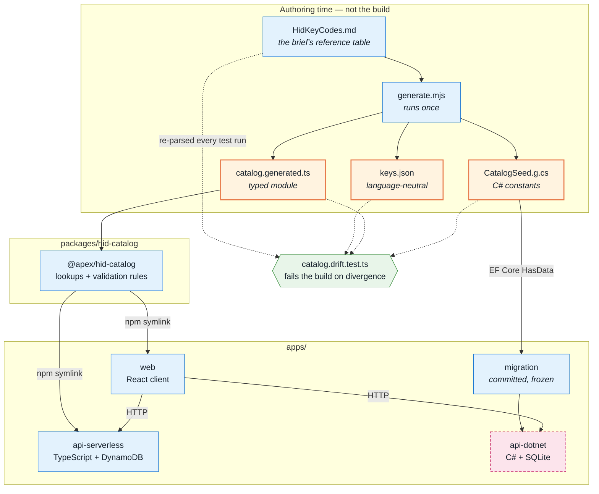
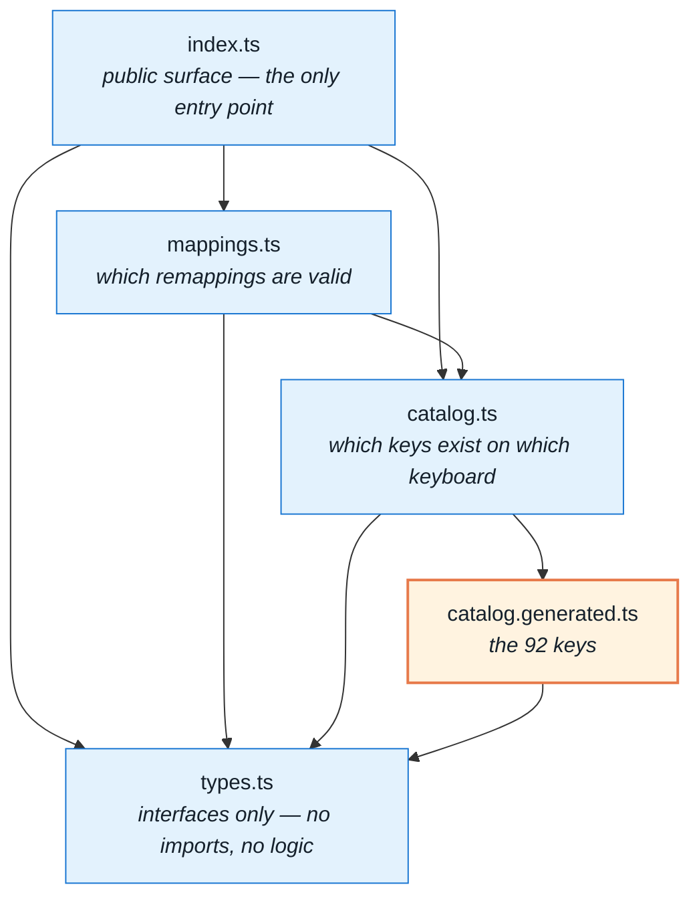
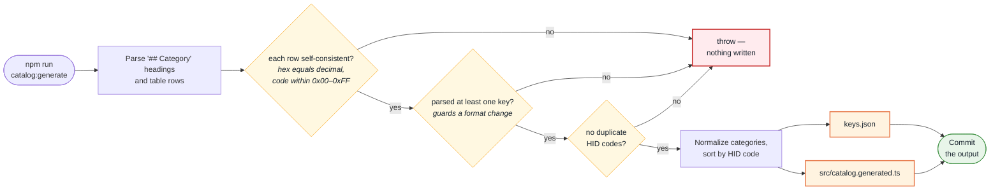
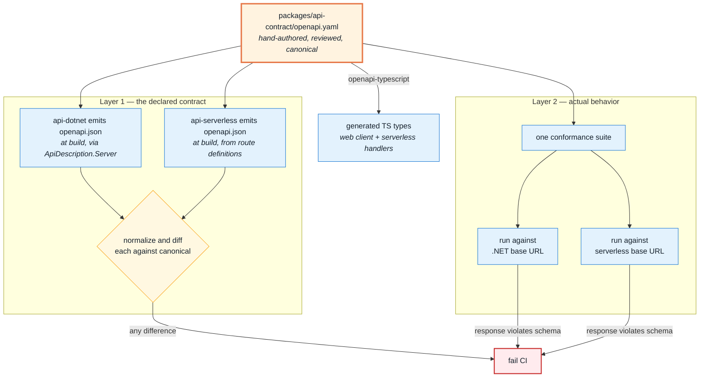
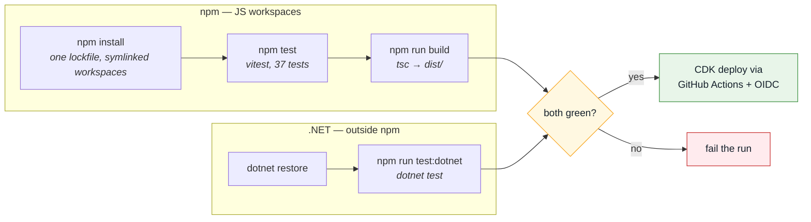
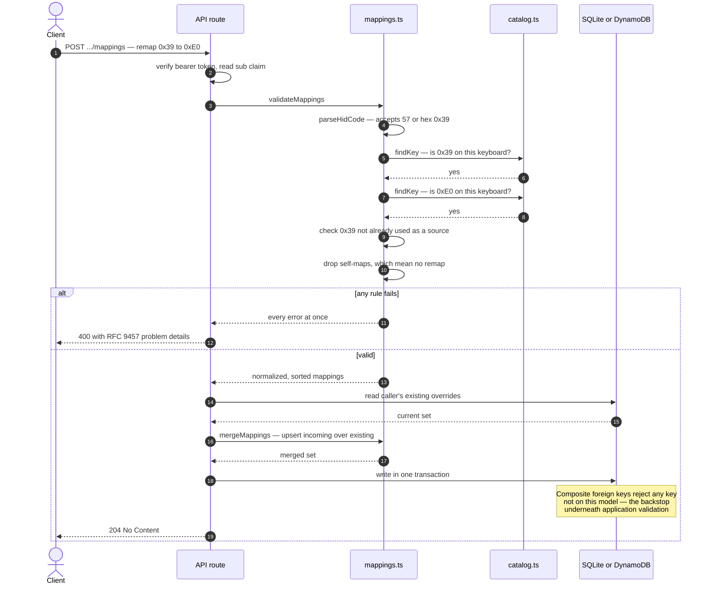

# Repository structure

How this monorepo is laid out, what belongs where, and which files are
generated. For the design of the service itself — data model, API contract,
auth — see [README.md](README.md).

---

## Why one repository

The same API is implemented twice, and a React client talks to both. Those
three deployables have to agree on exactly what a key is, which keys exist on
an Apex Pro Gen 3, and what makes a remapping valid. Split across three
repositories, that agreement would be maintained by hand and by hope: a change
to the key catalog would need three coordinated pull requests, and nothing
would fail when someone forgot the third.

Keeping them together means the shared rules live in one place, the two
implementations are diffable side by side, and one CI run proves the whole set
still agrees. The cost is a build that has to understand both npm and .NET,
which is a known and bounded problem.

This is the whole repository in one picture — where the key catalog comes from,
and how it reaches each of the three consumers:



Solid arrows are compiler-enforced. The dashed arrow into `api-dotnet` is the
one that is not, and the rest of this document explains why.

## Layout

```
apex-key-remapping/
├── KeyboardBindingsProblem.md    The assessment brief, unmodified
├── HidKeyCodes.md                Reference key table — a build input, not just documentation
├── README.md                     Design: data model, API contract, auth, tradeoffs
├── REPOSITORY.md                 This file
├── package.json                  npm workspaces root; cross-cutting scripts
├── package-lock.json             Single lockfile for every JS workspace
├── .gitignore
├── .vscode/
│   └── settings.json             Peacock color (SteelSeries orange), committed deliberately
│
├── packages/
│   ├── api-contract/             Canonical OpenAPI document both backends answer to
│   └── hid-catalog/              Shared domain: the key catalog and remapping rules
│
├── postman/                      GENERATED collection + environment
│
├── global.json                   Declares the minimum .NET SDK
├── apps/
│   ├── api-dotnet/               ASP.NET Core 10 + SQLite
│   │   ├── Apex.KeyMapping.sln
│   │   ├── .config/              Local dotnet-ef tool manifest
│   │   ├── Apex.KeyMapping.Api/
│   │   └── Apex.KeyMapping.Api.Tests/
│   ├── api-serverless/           TypeScript Lambda + DynamoDB  (not yet built)
│   └── web/                      React client  (not yet built)
│
├── infra/                        AWS CDK stacks  (not yet built)
└── .github/
    └── workflows/                Build, test, deploy  (not yet built)
```

The two packages and the .NET API exist today. The rest are in the
[roadmap](README.md#roadmap); `apps/api-serverless`, `apps/web` and
`.github/workflows/` are empty, and `infra/` has not been created yet.

### Inside `apps/api-dotnet`

```
Apex.KeyMapping.Api/
├── Program.cs                    Composition root; migrates on startup
├── Domain/                       The remapping rules, reimplemented in C#
│   ├── HidCode.cs                Parsing and hex rendering
│   ├── Keyboard.cs               Read model loaded from the database
│   └── MappingValidator.cs       Validation and merge semantics
├── Data/
│   ├── Entities.cs               The four tables
│   ├── ApexDbContext.cs          Schema, composite keys, HasData seeding
│   ├── CatalogSeed.g.cs          GENERATED — the 92 keys as C# constants
│   └── Migrations/               Committed and frozen
├── Contracts/                    Response shapes and RFC 9457 problems
├── Endpoints/MappingEndpoints.cs The seven operations
└── Identity/IOwnerAccessor.cs    The seam Cognito plugs into
```

The split that matters is `Domain/` knowing nothing about EF Core or HTTP.
`MappingValidator` takes a `Keyboard` read model and a `JsonElement` and
returns a result; it never touches a `DbContext`. That is what lets the
validation rules be compared against the TypeScript original without a
database in the picture.

[apps/api-dotnet/REPOSITORY.md](apps/api-dotnet/REPOSITORY.md) covers that
project on its own terms — dependency injection, minimal APIs, EF Core
migrations and the project's conventions — written to be readable without prior
.NET experience.

## What goes where

Three buckets, and the rule for each:

| Directory | Holds | Test |
|---|---|---|
| `packages/` | Code consumed by something else in the repo | Nothing deploys it on its own |
| `apps/` | Independently deployable units | You could point a browser or `curl` at it |
| `infra/` | The AWS resources the apps run on | It describes cloud, not behavior |

A package has no deployment of its own and no opinion about HTTP. An app owns
its own build, its own configuration and its own URL. When something in an app
turns out to be needed by a second app, that is the signal to move it down into
`packages/` — not before, because a package shared by one consumer is just
indirection.

## The npm workspace

The root [package.json](package.json) is private and declares the JS members:

```json
"workspaces": ["packages/*", "apps/api-serverless", "apps/web", "infra"]
```

One `npm install` at the root links them together and produces a single
`package-lock.json`, so every workspace resolves the same version of every
dependency. The serverless API and the web client will depend on the shared
package by name — `"@apex/hid-catalog": "*"` — and npm symlinks it rather than
fetching anything, so an edit to the domain rules is visible to both
immediately with no publish step.

`packages/*` is a glob; the two apps and `infra` are listed explicitly rather
than as `apps/*`, which matters because of what is missing from that list.

### The .NET seam

`apps/api-dotnet` is **not** an npm workspace, because .NET does not
participate in npm. This is the one real seam in the repository and it is worth
being plain about: "shared domain contract" means two different things
depending on which side you are on.

| Consumer | How it gets the contract | Enforced by |
|---|---|---|
| `api-serverless` | Imports `@apex/hid-catalog` | The TypeScript compiler |
| `web` | Imports `@apex/hid-catalog` | The TypeScript compiler |
| `api-dotnet` | C# reimplementation, catalog seeded from generated output | Tests asserting identical behavior |

Two consumers share an implementation. The third shares a specification. So
the validation rules in [mappings.ts](packages/hid-catalog/src/mappings.ts)
exist twice in this repository — once in TypeScript, once in C# — and what
keeps them honest is a test suite, not the type system.

That is a deliberate acceptance, not an oversight. The alternatives were to
make the brief's preferred language a client of a Node service, or to generate
C# from TypeScript, and both buy more complexity than a second 180-line
implementation with tests pointed at it.

The build follows the same split: `npm test` runs the JS workspaces,
`npm run test:dotnet` shells out to `dotnet test`. CI will run both and treat
either failure as a failure.

## Inside `packages/hid-catalog`

```
packages/hid-catalog/
├── package.json                  @apex/hid-catalog — private, ESM, exports dist/
├── tsconfig.json                 strict, NodeNext, emits declarations to dist/
├── generate.mjs                  Authoring-time generator (see below)
├── keys.json                     GENERATED — language-neutral catalog
└── src/
    ├── types.ts                  Interfaces only: HidKey, Keyboard, KeyMapping, responses
    ├── catalog.generated.ts      GENERATED — the 92 keys as a typed module
    ├── catalog.ts                What keys exist: lookups, hex parsing
    ├── mappings.ts               What remaps are legal: validate, merge, project
    ├── index.ts                  Public surface — the only entry point
    ├── mappings.test.ts          31 tests
    └── catalog.drift.test.ts     6 tests
```

### Layering

Each source file depends only on the ones below it. Arrows point from a file to
what it imports:



There are no cycles and nothing points upward. `mappings.ts` asks `catalog.ts`
whether a key exists. `catalog.ts` knows
nothing about remapping, so the validation rules can change without touching
the key data and the catalog can gain a second keyboard model without touching
validation. Everything outside the package imports from `index.ts`, never from
a file inside `src/` directly, so the internal arrangement stays free to move.

### Generated files

Two files are emitted by [generate.mjs](packages/hid-catalog/generate.mjs) and
must not be hand-edited. The generator refuses to write anything it cannot
fully verify first:



Those gates matter because the input is a hand-written markdown table in a
document nobody on this side controls. A silently mis-parsed row would become
92 committed keys with one wrong entry, and the first sign of trouble would be
a remap that mysteriously fails validation. Throwing on contradiction makes
that a loud authoring-time error instead.

It emits the same catalog twice on purpose. `keys.json` is the data with no
language attached, which is what the .NET side consumes. `catalog.generated.ts`
is a TypeScript module rather than a JSON import because `tsc`, `esbuild`,
`vite` and `vitest` do not agree on JSON import attributes or on copying JSON
into build output — emitting a `.ts` module sidesteps four separate
configuration problems.

**The generator runs once, at authoring time.** It is not part of the build and
not part of the runtime. Its output is committed, which is what lets the .NET
migration that seeds the catalog be a frozen, reviewed artifact — as migrations
have to be.

```bash
npm run catalog:generate     # only when HidKeyCodes.md changes
```

### The drift test

The catalog now exists in three places: the brief's `HidKeyCodes.md`, the
generated `keys.json`, and the generated TypeScript module. Three copies of
anything will eventually disagree, so
[catalog.drift.test.ts](packages/hid-catalog/src/catalog.drift.test.ts)
re-parses the source document on every test run and asserts:

- `keys.json` and the TypeScript module are identical
- every key documented in `HidKeyCodes.md` is in the catalog, and the counts match
- no duplicate HID codes, every code inside `0x00`–`0xFF`
- `hidCodeHex` is consistent with `hidCode` for every key
- the Apex Pro Gen 3 still has exactly 92 keys

So if the reference table changes and nobody regenerates, the build fails
rather than the two implementations quietly drifting apart. This is what makes
the committed generated files safe to trust.

## Keeping the two backends in contract

The repository claims the same API is implemented twice. That claim needs
enforcing, or it decays the first time someone fixes a status code in one
backend and not the other.

Publishing Swagger documentation is the obvious move and it is not sufficient
on its own. Two services can emit byte-identical OpenAPI documents and still
disagree in practice: both declare `400` for a bad mapping, but one actually
returns `422`; both declare `from` accepts a string, but one rejects `"0x39"`
and the other coerces it. A document describes intent. It does not prove
behavior.

So this is enforced in two layers, and the second is the one that really
binds.



### Why the document is hand-authored

The tempting approach is code-first: let each backend generate its own
OpenAPI, then diff the two against each other. That fails in a specific way.
Whichever backend gets written first silently becomes the specification, and
when the second one disagrees there is nothing to say which is right — the
diff reports a difference, not a fault. Worse, a deliberate contract change
in the first backend reads as the second backend breaking.

[`openapi.yaml`](packages/api-contract/openapi.yaml) is therefore written and
reviewed by hand and lives in `packages/` as a peer to the domain rules. Both
backends are measured against something decided on purpose. When a backend
disagrees with it, the backend is wrong until the document is deliberately
changed — and changing it is a reviewable diff in its own right.

It is the single place that defines all 7 operations, the `HidCodeInput` rule
that decimal and hex are both accepted, the RFC 9457 error shape, and the
promise that `mappedTo` is never null.

### Layer 1: the declared contract

Each backend emits its own OpenAPI document at **build** time, not at runtime,
so the comparison needs no running server:

- **.NET** — `Microsoft.AspNetCore.OpenApi` generates the document, and
  [`Microsoft.Extensions.ApiDescription.Server`](https://www.nuget.org/packages/Microsoft.Extensions.ApiDescription.Server)
  writes it to disk during `dotnet build`. Both are first-party Microsoft
  packages, which keeps the brief's "no licensed third-party packages"
  constraint satisfied.
- **Serverless** — the handler route definitions emit the equivalent document.

CI normalizes both — key ordering, `$ref` expansion, OpenAPI version — and
compares each to the canonical file. Any difference fails the build.

Two practical notes that are easy to get wrong. Both generators must be pinned
to the **same OpenAPI version**, because a 3.0 document and a 3.1 document of
the same API differ structurally (nullability and `examples` in particular) and
the diff becomes unreadable noise. And normalization has to happen before
comparison, since neither generator guarantees stable key ordering.

### Layer 2: actual behavior

One conformance suite, parameterized by base URL, run twice:

```bash
APEX_API_BASE_URL=http://localhost:5080 npm run test:conformance   # .NET
APEX_API_BASE_URL=http://localhost:3000 npm run test:conformance   # serverless
```

Identical requests go to each backend and every response is validated against
the canonical schemas — status code, headers, and body shape. This is what
catches the failures a document diff cannot see: divergent coercion of
`"0x39"` versus `57`, a `remappedCount` that counts self-maps in one
implementation, an error body that drops the `errors` array under load.

Because the suite is written against the spec rather than against either
implementation, it is also the definition of done for each one. The serverless
API is finished when it passes the same suite the .NET API passes.

This lands with the .NET API in roadmap step 2 — there is nothing to point it
at yet, and a permanently skipped test suite is worse than an absent one.

### The Postman collection

[`postman/`](postman) is a third derived artifact, generated from the same
document by
[`generate-postman.mjs`](packages/api-contract/generate-postman.mjs). Routes,
methods, descriptions and request bodies all come out of `openapi.yaml`, so a
contract change regenerates the collection rather than leaving a second,
quietly diverging description of the API.

What is deliberately **not** derived is the assertions. A plain
OpenAPI-to-Postman conversion produces an API browser — requests you can fire,
with nothing checking the answers. The test scripts are hand-written, and the
scenario folder is an ordered walk through the behavior the brief asks for:
apply the brief's mappings, read the layout back, confirm a second user sees
nothing, clear a binding by self-mapping it, confirm an invalid remap is
rejected with every error at once and changes nothing.

```bash
npm run postman:generate
npm run postman:test        # newman, against a running API
```

Since every request targets `{{baseUrl}}`, pointing it at the serverless
implementation later is an environment change. That makes it a usable first
version of the conformance suite above, available well before the second
backend exists.

> It earned its place immediately: on its first run it caught the .NET API
> serializing `"errors": null` on a 404, where the contract declares `errors`
> as an array present only on validation failures. The serverless
> implementation, written from the same document, would have omitted the field
> — so the two backends would have disagreed on a response shape that
> everything else said was identical.

### What runs today

[`validate.mjs`](packages/api-contract/validate.mjs) checks the canonical
document itself, and it does more than an off-the-shelf linter would. The
structural checks are routine: `$ref`s resolve, `operationId`s are unique,
every secured route documents a `401`, every route taking a body documents a
`400`.

The checks that earn their place are the domain ones. Every HID code, key name,
category and key count appearing anywhere in the spec is verified against
`packages/hid-catalog/keys.json`:

| Check | Catches |
|---|---|
| Example key names match the catalog | A spec saying `0x1D` is `Q` when it is `Z` |
| Example categories match the catalog | `Caps Lock` documented as a modifier |
| `hidCodeHex` is canonical for `hidCode` | `{ hidCode: 29, hidCodeHex: "0xFF" }` |
| Every remapped code is a real key | An example remapping to `0x64`, which is not on this keyboard |
| `totalKeys` equals the real count | Documentation still claiming 92 after the catalog grows |
| The `category` enum matches the catalog exactly | A category added to the seed but not the contract |

That last set matters because a specification that drifts from the domain is
worse than no specification: both backends are written against it, so a wrong
example propagates into two implementations and their tests.

All of these were verified by mutating the spec and confirming each mutation
fails — a check that cannot fail is not a check.

## Commands

All from the repository root.

| Command | Does |
|---|---|
| `npm install` | Links every JS workspace, one lockfile |
| `npm test` | Tests across JS workspaces — 37 domain tests, plus contract validation |
| `npm run contract:validate` | Checks `openapi.yaml` against itself and the catalog |
| `npm run postman:generate` | Regenerates the Postman collection from the contract |
| `npm run postman:test` | Runs the collection against a running API via `newman` |
| `npm run build` | Builds every JS workspace that defines a build |
| `npm run lint` | Lints every JS workspace that defines a lint |
| `npm run test:dotnet` | `dotnet test apps/api-dotnet` |
| `npm run catalog:generate` | Regenerates the catalog from `HidKeyCodes.md` |
| `npm run dev:dotnet` | Runs the .NET API |
| `npm run dev:serverless` | Runs the serverless API locally |
| `npm run dev:web` | Runs the React client |

`build`, `test` and `lint` use `--workspaces --if-present`, so a workspace
without that script is skipped rather than failing the run. That is what lets
the scripts be written once now and keep working as each app lands.

The two toolchains run side by side and both have to pass:



The deploy stage is roadmap step 7 and does not exist yet; the two test lanes
do.

Requires Node 22+ and the .NET 10 SDK. No licensed third-party packages, as
the brief requires.

## How a request flows through these modules

Structure only matters if it holds up under a real request. This is a `POST` of
one remapping, and which file in the package does each part:



Two things to notice. Validation collects **every** failure before returning,
rather than stopping at the first — which is why `validateMappings` builds an
error array instead of throwing. And the database constraints re-check the same
rules the application just checked; that redundancy is deliberate, documented
in [README.md](README.md#data-model), and means a future caller that bypasses
the domain layer still cannot store a mapping to a key that does not exist.

`GET` is the same picture with `buildMappingsResponse` in place of validation,
projecting the stored overrides onto all 92 keys so every key comes back
whether it is remapped or not.

## Conventions

**Adding a JS app or package.** Create the directory with its own
`package.json` named `@apex/<name>`, add it to the root `workspaces` array if
it is not covered by `packages/*`, and give it `build`, `test` and `lint`
scripts so the root commands pick it up. Then `npm install` at the root.

**Changing the contract also regenerates the collection.** After editing
`openapi.yaml`, run `npm run postman:generate`. Never hand-edit anything under
`postman/` — it is generated output, and Postman's own "export" would
overwrite the structure the generator produces.

**Adding keys or a keyboard model.** Edit `HidKeyCodes.md`, run
`npm run catalog:generate`, and add a .NET migration inserting the new rows.
Never edit `keys.json` or `catalog.generated.ts`. The drift test will tell you
if you missed the regeneration step, and `contract:validate` will tell you if
the OpenAPI document still describes the old key count or category set.

**Changing the API.** Edit [`openapi.yaml`](packages/api-contract/openapi.yaml)
first, in its own reviewable commit, then change both backends to match. Doing
it the other way round makes whichever backend you touched first the de facto
specification. A backend that disagrees with the canonical document fails CI,
which is the intended pressure.

**What is committed.** Source, lockfile, generated catalog files, and the
shared VS Code settings. Not committed: `node_modules/`, `dist/`, .NET
`bin/`/`obj/`, `cdk.out/`, local SQLite databases, and anything matching
`.env*` except `.env.example`. The `.gitignore` already covers artifacts from
tooling that has not landed yet, so the first .NET build and the first CDK
synth do not pollute `git status`.

**Database files are not source.** The .NET app creates `apex.db` on first run
by applying migrations. Deleting it is the supported way to reset local state;
the next run re-creates and re-seeds it.
