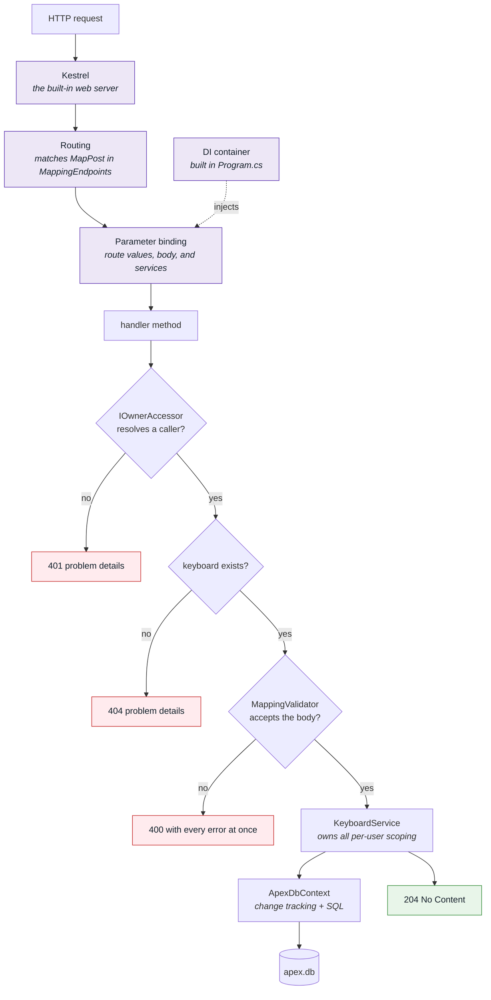
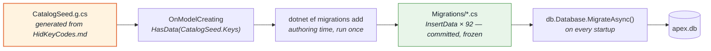

# The .NET API

How this project is put together, and enough ASP.NET Core and EF Core to read
it without prior .NET experience. For the repository as a whole see
[../../REPOSITORY.md](../../REPOSITORY.md); for the service's design see
[../../README.md](../../README.md).

---

## What this is

An **ASP.NET Core 10 Minimal API** backed by **SQLite** through **EF Core**. It
is the literal answer to the brief: C#, a database file that persists between
runs, no licensed third-party packages.

```bash
cd ../..                  # repository root
npm run dev:dotnet        # http://localhost:5080
npm run test:dotnet
```

## .NET vocabulary, in npm terms

If npm is your reference point, most of the moving parts map across cleanly.

| .NET | npm equivalent | Here |
|---|---|---|
| Solution (`.sln`) | Workspace root | `Apex.KeyMapping.sln` |
| Project (`.csproj`) | A package with its own `package.json` | `Apex.KeyMapping.Api`, `...Api.Tests` |
| NuGet | npm registry | Packages are listed *inside* the `.csproj` |
| `dotnet restore` | `npm install` | Usually implicit — `build` and `run` do it |
| Local tool manifest | `devDependencies` for CLIs | `.config/dotnet-tools.json` |
| `TargetFramework` | `engines.node` | `net10.0` |
| Namespace | Module path | Mirrors the folder structure by convention |

Two differences worth internalizing early:

**There is no `node_modules`.** Packages resolve from a machine-wide cache at
`~/.nuget/packages`, and `obj/` plus `bin/` hold per-project build state. All
three are disposable; none are committed.

**Dependencies live in the project file.** `Apex.KeyMapping.Api.csproj` is both
the manifest and the build script:

```xml
<PropertyGroup>
  <TargetFramework>net10.0</TargetFramework>
  <Nullable>enable</Nullable>          <!-- string vs string? is enforced -->
  <ImplicitUsings>enable</ImplicitUsings>  <!-- common usings are automatic -->
</PropertyGroup>

<ItemGroup>
  <PackageReference Include="Microsoft.EntityFrameworkCore.Sqlite" Version="10.0.15" />
</ItemGroup>
```

`ImplicitUsings` is why files here do not `using System;` — the SDK injects the
common ones. `Nullable` is why the compiler objects to dereferencing a `string?`
without a check; it is roughly TypeScript's `strictNullChecks`.

Versions are pinned exactly rather than floated (`10.0.15`, not `10.*`), so a
reviewer restores what was actually built and tested.

## Project layout

```
apps/api-dotnet/
├── Apex.KeyMapping.sln            Groups the two projects
├── .config/dotnet-tools.json      Pins dotnet-ef so migrations work after clone
├── Apex.KeyMapping.Api/
│   ├── Apex.KeyMapping.Api.csproj
│   ├── Program.cs                 Composition root — start reading here
│   ├── Properties/launchSettings.json   Local run profiles (port, environment)
│   ├── Domain/                    Remapping rules. No HTTP, no database.
│   │   ├── HidCode.cs             Parse "0x04" / 4 / "1D"; render 0x04
│   │   ├── Keyboard.cs            Read model + small value types
│   │   └── MappingValidator.cs    Validation and merge semantics
│   ├── Data/                      Persistence
│   │   ├── Entities.cs            The four tables as classes
│   │   ├── ApexDbContext.cs       Schema configuration and seeding
│   │   ├── CatalogSeed.g.cs       GENERATED — do not edit
│   │   └── Migrations/            Committed and frozen
│   ├── Contracts/                 What goes out on the wire
│   │   ├── Responses.cs           Response shapes + projection
│   │   └── ApiProblem.cs          RFC 9457 errors
│   ├── Endpoints/
│   │   └── MappingEndpoints.cs    The seven routes
│   └── Identity/
│       └── IOwnerAccessor.cs      Who is calling; the seam Cognito plugs into
└── Apex.KeyMapping.Api.Tests/
    ├── ApiFactory.cs              Boots the real app against a temp database
    ├── MappingApiTests.cs         Contract behavior over HTTP
    └── SchemaConstraintTests.cs   Proves the database constraints are real
```

The important boundary is that **`Domain/` knows nothing about EF Core or
HTTP**. `MappingValidator.Validate` takes a keyboard and parsed JSON and
returns a result. It never touches a database, which is what lets the rules be
compared against the TypeScript original directly.

## How a request flows



## Dependency injection

This is the concept that most surprises newcomers, because it changes how you
read a method signature.

`Program.cs` registers services into a container:

```csharp
builder.Services.AddDbContext<ApexDbContext>(o => o.UseSqlite(connectionString));
builder.Services.AddScoped<KeyboardService>();
builder.Services.AddSingleton(TimeProvider.System);
builder.Services.AddScoped<IOwnerAccessor, DevelopmentOwnerAccessor>();
```

Then a handler simply *asks* for what it needs, and the framework supplies it:

```csharp
private static async Task<IResult> GetMappings(
    string keyboard,            // from the route: /api/keyboards/{keyboard}/mappings
    IOwnerAccessor owner,       // from the DI container
    KeyboardService service,    // from the DI container
    CancellationToken ct)       // from the framework
```

Nothing constructs `KeyboardService`. The container sees the parameter type,
finds the registration, builds it — and builds `ApexDbContext` and
`TimeProvider` for its constructor too, recursively.

The three lifetimes:

| Lifetime | Meaning | Used here for |
|---|---|---|
| `AddSingleton` | One instance for the whole process | `TimeProvider` — stateless |
| `AddScoped` | One per HTTP request | `KeyboardService`, `ApexDbContext`, `IOwnerAccessor` |
| `AddTransient` | A new one every time it is asked for | not used |

Scoped is the right default for anything touching the database: each request
gets a fresh `DbContext` with its own change tracker and transaction scope, and
it is disposed when the response completes.

The payoff is visible in `IOwnerAccessor`. Swapping the development header for
real Cognito validation means changing **one registration line** — no endpoint
signature changes, because they only ever asked for the interface.

## Minimal APIs

Routes are registered as functions rather than declared with controller
classes and attributes:

```csharp
var api = app.MapGroup("/api/keyboards");
api.MapGet("/{keyboard}/mappings", GetMappings).WithName("getMappings");
```

`MapGroup` applies a common prefix. `WithName` sets the `operationId` in the
generated OpenAPI document — which is exactly what CI diffs against
[the canonical contract](../../packages/api-contract/openapi.yaml), so those
names are part of the contract, not decoration.

Handlers return `IResult`: `Results.Ok(value)`, `Results.NoContent()`, or in
this project `ApiProblem.ValidationFailed(errors)`, which wraps
`Results.Json(...)` with `application/problem+json`.

### Binding, and one deliberate choice

ASP.NET Core would happily bind the request body to a typed class. This project
takes `JsonElement` instead:

```csharp
private static Task<IResult> AddMappings(string keyboard, JsonElement body, ...)
```

That looks like giving up type safety, and it is a trade made on purpose. The
contract promises *every* validation failure is reported at once. If the body
bound to a typed model, malformed entries would fail during deserialization and
the request would be rejected with a framework error before the domain rules
ever ran — one error, in the wrong shape. Reading the raw JSON lets
`MappingValidator` walk every entry and collect all of them, and it is also
what allows `{ "from": 4 }` and `{ "from": "0x04" }` to both be valid.

## EF Core

EF Core is an ORM. Three ideas cover most of what happens here.

**`DbContext` is a session.** `ApexDbContext` exposes `DbSet<T>` properties
that behave like queryable collections. LINQ against them becomes SQL:

```csharp
await db.KeyMappings
    .Where(m => m.UserKeyboard!.OwnerSub == ownerSub)
    .OrderBy(m => m.FromHidCode)
    .ToListAsync(ct);
```

**Change tracking.** Entities loaded through a context are watched; mutating a
property and calling `SaveChangesAsync()` issues an `UPDATE`. That is why
`KeyboardService.ApplyAsync` can assign `row.ToHidCode = target` and simply
save. `AsNoTracking()` opts out for read-only queries, which is faster and
avoids surprises.

> This bit us while writing tests: EF's change tracker rejected a duplicate key
> *client-side* before the database could, so the test proving the database
> enforces it needed a second `DbContext`. See `SchemaConstraintTests`.

**`OnModelCreating` configures the schema** with the fluent API — primary keys,
indexes, relationships, check constraints. This project leans on it hard,
because the schema is meant to make bad data unstorable:

```csharp
entity.HasKey(e => new { e.UserKeyboardId, e.FromHidCode });   // remapped at most once

entity.HasOne<KeyboardKey>()
    .WithMany()
    .HasForeignKey(e => new { e.KeyboardModelId, e.ToHidCode }); // target must be a real key
```

### Migrations

A migration is a committed, timestamped C# file describing a schema change.
`Migrations/20261118220834_InitialSchemaAndCatalog.cs` creates the four tables
and inserts the 92 catalog rows.



Two rules follow from migrations being frozen:

- **Never edit a migration that has been applied anywhere.** Databases record
  which migrations they have run; changing one in place puts them permanently
  out of step. Add a new migration instead.
- **Never edit `CatalogSeed.g.cs`.** Change `HidKeyCodes.md`, run
  `npm run catalog:generate`, then add a migration for the new rows. A drift
  test fails the build if the generated file and `keys.json` disagree.

`dotnet-ef` is the CLI that writes migrations. It is pinned as a local tool, so
after cloning:

```bash
dotnet tool restore                     # once, reads .config/dotnet-tools.json
dotnet ef migrations list --project Apex.KeyMapping.Api
dotnet ef migrations add <Name> --project Apex.KeyMapping.Api --output-dir Data/Migrations
```

Migrations are applied automatically at startup in `Program.cs`, so the first
run creates and seeds `apex.db` with no setup step. That is a deliberate
convenience for a reviewer rather than a production pattern — a real deployment
runs migrations as a separate gated step, not from inside a scaling web app.

## Testing

Tests use **xunit**. `[Fact]` marks a test. `IClassFixture<T>` shares one
expensive object across a class — here, the whole running application.

`ApiFactory` extends `WebApplicationFactory<Program>`, which boots the **real**
`Program.cs` in-process and hands out an `HttpClient` wired straight to it. No
network, no separate process, but genuine routing, DI, model binding and
serialization:

```csharp
var response = await client.PostAsync(Route, Mappings((0x04, 0x1D)));
Assert.Equal(HttpStatusCode.NoContent, response.StatusCode);
```

It overrides two settings: a throwaway SQLite file per factory, and
`Development` so the header-based `IOwnerAccessor` is registered and tests can
act as different users.

The suites split by what they prove:

- `MappingApiTests` — the contract, over HTTP, as a client sees it
- `SchemaConstraintTests` — that the database constraints are real, by writing
  through `DbContext` and expecting failure

## Gotchas

Things that cost time here, recorded so they cost less next time.

**`dotnet new sln` now defaults to `.slnx`.** The newer XML solution format is
not understood by every tool. If your editor shows errors the compiler does not
— especially `CS8795` on the `[GeneratedRegex]` methods in `HidCode.cs` — the
language server has not loaded the project and is not running source
generators. This project uses a classic `.sln` for that reason; reload the
window after changing it.

**The default environment is `Production`.** With no `ASPNETCORE_ENVIRONMENT`
set, `IsProduction()` is true — including during `dotnet build`, because the
OpenAPI document generator starts the host to read the routes. Anything that
throws on a production-only path will break the *build*. `launchSettings.json`
sets `Development` for `dotnet run`, and the production path here fails closed
(401s) rather than refusing to start.

**SQLite enforces foreign keys per connection.** The `sqlite3` CLI defaults to
off, so testing constraints there needs `PRAGMA foreign_keys=ON`.
`Microsoft.Data.Sqlite` turns them on by default, which
`SchemaConstraintTests.Foreign_keys_are_enforced_on_the_applications_own_connections`
verifies rather than assumes.

**`dotnet --version` is not the target framework.** `global.json` at the
repository root declares the minimum SDK with `rollForward: latestMajor`, so a
newer SDK may report itself while the project still targets `net10.0`. That is
expected — newer SDKs build older target frameworks.

## Command reference

From this directory unless noted.

| Command | Does |
|---|---|
| `dotnet build` | Builds the solution; also regenerates the OpenAPI document |
| `dotnet test` | Runs both test projects |
| `dotnet run --project Apex.KeyMapping.Api` | Starts the API on :5080 |
| `dotnet tool restore` | Installs `dotnet-ef` from the manifest |
| `dotnet ef migrations list --project Apex.KeyMapping.Api` | Shows applied and pending migrations |
| `rm Apex.KeyMapping.Api/apex.db` | Resets local data; next run re-creates and re-seeds |
| `npm run dev:dotnet` (repo root) | Same as `dotnet run`, from the workspace root |
| `npm run test:dotnet` (repo root) | Same as `dotnet test`, from the workspace root |
